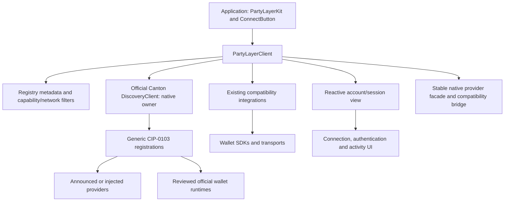

# PartyLayer architecture

## Current application entry point

Existing React applications install `@partylayer/react @tanstack/react-query`,
configure `PartyLayerKit`, and render `ConnectButton`. The kit creates the public
`PartyLayerClient`; its default catalog loads reviewed wallet runtimes through
shared bridges. No additional PartyLayer package is required per wallet.
WalletConnect project IDs, enterprise credentials and beta/network selection
remain application configuration. See [Quick start](./quick-start.md).

The unpublished candidate uses official discovery 1.15.0 as the browser-native
connection owner. Existing proprietary/custom adapters and the existing WalletConnect
wrapper retain their compatibility boundary. See [Protocol ownership](./protocol-ownership.md)
for the reviewed public APIs, protected extension transport and release gates.

## Package responsibilities

| Package | Responsibility |
| --- | --- |
| `@partylayer/core` | Shared contracts, capabilities, errors, CAIP-2 network helpers and token types |
| `@partylayer/core/authentication` | Server-safe challenge formatting and verification orchestration; application supplies authorized signature verification and atomic nonce storage |
| `@partylayer/core/amounts` | Server-safe exact decimal summation |
| `@partylayer/registry-client` | Fetch, validate and cache wallet metadata; never import executable code from registry-provided URLs |
| `@partylayer/sdk` | Default runtime loaders, one official browser-native owner, constrained session projections and public wallet actions |
| `@partylayer/provider` | Direct provider wrapper, CIP-0103 error/event helpers and `createProviderBridge`; `client.asProvider()` exposes the existing client |
| `@partylayer/session` | Reactive connection/account views; the React default is an in-memory projection of the SDK provider |
| `@partylayer/react` | Kit, default branded UI, themes, locale, authentication and transaction/activity/holdings views |
| `@partylayer/react/query` | Read queries and ledger-write mutations; write retries are disabled to avoid duplicate submissions |
| `@partylayer/vue`, `@partylayer/react-native` | Platform bindings with their documented feature sets; React additions do not imply full cross-platform parity |
| Existing `@partylayer/adapter-*` packages | Compatibility with existing integrations; closed to new per-wallet PartyLayer packages |

New wallets use the [generic integration paths](./generic-bridge.md). The registry
advertises metadata, network/channel availability and supported capabilities.
A capability must also have a real implementation; no universal sign-only,
network-switching or event support is inferred from a wallet appearing in the picker.

## Connection and restored identity

The SDK warms approved lazy loaders before an explicit connection click. Bridges
preserve the synchronous hosted-wallet opening path. Explicitly declined
handshakes and empty primary parties cannot create an active connection.

A saved PartyLayer native session is only a constrained projection. Restoration
requires the official provider hint and live identity validation, including primary
party, network policy and expiry. Old native caches need one explicit reconnect.
A provider change requires reconnection rather than silently relabeling cached
identity. OneSwap currently requires a fresh explicit connection.

Connection revisions prevent old approvals or restores from overwriting a newer
connection. Session storage writes/removals are serialized and revision-checked;
a late logout cannot erase a subsequently connected session. Destroyed clients
cannot revive a connection. Session metadata storage is not a secret vault or
backend authorization mechanism. Do not persist private keys or recovery phrases.

Some popup wallets do not emit account/network events. The UI must not imply
instant change detection in those wallets; refresh/reconnect and validate the
active identity before sensitive operations. Selecting a party or switching a
network requires the wallet's documented interface; there is no invented
universal CIP-0103 setter.

## Authentication boundary

Wallet connection establishes a wallet session. Application login additionally
requires a single-use server challenge and independently authorized signature
verification. `PartyLayerKit.authentication` integrates those backend endpoints;
`ConnectButton` supplies explicit sign-in and sign-out actions.

Challenges are prepared before a click to preserve hosted-wallet popup activation.
Signatures are never requested automatically on mount. The backend binds and
atomically consumes the nonce for the same browser, verifies origin/party/network
and exact message bytes, and independently checks the signing key's authority.
It enforces CSRF protection, session expiry and authorization on every sensitive
request. Origin-bound local wallet metadata does not provide CSRF protection.
See [Application authentication](./authentication.md).

## Transactions and holdings

The application constructs valid Canton commands for transfers or protocol-specific
swaps. PartyLayer routes supported signing/submission calls; a message signature
alone does not establish that either ledger operation works.

`useTransactionFlow` performs one wallet write, then optionally reconciles through
an independent read-only ledger/backend callback. Submission acknowledgement,
ledger confirmation, rejection, failure and an unknown outcome remain distinct.
A timeout or lost response never authorizes an automatic second write.
Recent activity is in-memory and scoped by wallet, party and CAIP-2 network;
it is not a complete ledger history. See [Transaction lifecycle](./transaction-lifecycle.md).

Holdings come from the application's authorized, complete snapshot. The UI checks
party/network scope, separates instrument issuers, uses exact decimal strings,
and keeps reported locks separate. Incomplete or malformed reads cannot become a
zero balance. See [Wallet balances](./wallet-balances.md).

## Validation and remaining acceptance

`pnpm gate` covers workspace builds, tests, public API/packaging snapshots, native
provider conformance, registry/template/docs drift, packed npm consumers and
browser checks. Browser-required compatibility suites are explicitly skipped in
CI; mocked transports and local cryptographic test keys do not establish live
wallet compatibility or vendor-specific signature verification.

See [Release process](./releasing.md#default-wallet-release-validation) for actual
wallet evidence and [Platform roadmap](./platform-roadmap.md) for open work.
Loop's key-unlock failure, valid Vala Devnet transactions, full live transfer/swap
acceptance, final native-owner release validation and the full accessibility
review remain separate completion criteria.
